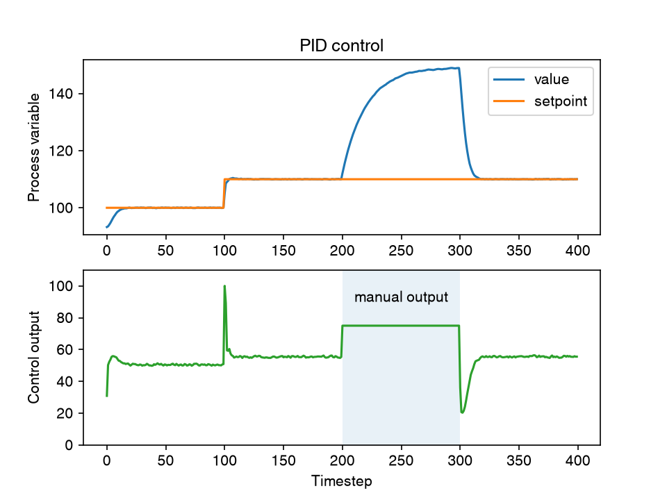

[](https://github.com/asteppke/tinypid/actions/workflows/python-app.yml)

# Tiny PID
Minimal, dependency-free PID controller for Python (>=3.8).

## Installation
Not (yet) published on PyPI. Install directly from this repository:
````
pip install git+https://github.com/asteppke/tinypid.git
````
or clone it and install in editable mode for local development:
````
git clone https://github.com/asteppke/tinypid.git
cd tinypid
pip install -e .
````

## Quick start
````
import tinypid

controller = tinypid.PID(k_p=1.0, k_i=0.1, k_d=0.0, setpoint=0.0)

value = 10
output = controller(value)
````

## Optional features
- [Output limiting](#output-limiting)
- [Anti-windup mechanism](#anti-windup-mechanism)
- [Lowpass filtering of derivative component](#lowpass-filtering-of-derivative-component)
- [Bumpless transfer between manual and automatic control](#bumpless-transfer-between-manual-and-automatic-control)
- [Gain scheduling](#gain-scheduling)
- [Feed forward component](#feed-forward-component)
- [Output rate limiting](#output-rate-limiting)
- [Output dead-band](#output-dead-band)
- [Output dithering](#output-dithering)
- [Combining multiple features](#combining-multiple-features)


### Output limiting
````
upper_limit = 10 
lower_limit = -10
controller = tinypid.PID(upper_limit=upper_limit, lower_limit=lower_limit)

value = 10000

for i in range(100):
    output = controller(value)
    value += output
    assert lower_limit <= output <= upper_limit

````

### Anti-windup mechanism
Prevents the integral term from accumulating further while the output is saturated. Enabled by default, can be disabled via `anti_windup=False`.
````
controller = tinypid.PID(k_p=10.0, k_i=1.0, setpoint=100.0, upper_limit=5.0, lower_limit=-5.0)

for _ in range(5):
    output = controller(0.0)  # large error keeps the output saturated at upper_limit

assert controller.integral == 0.0  # anti-windup (default) kept the integral from growing
````

### Lowpass filtering of derivative component
Smooths the derivative term to reduce sensitivity to noisy measurements. `derivative_lowpass` ranges from 0 (heavy filtering) to 1 (no filtering).
````
controller = tinypid.PID(k_d=1.0, setpoint=10.0, derivative_lowpass=0.2)

for value in [8.0, 9.0, 7.0, 9.5]:
    output = controller(value)
````

### Bumpless transfer between manual and automatic control
Passing `manual_output` back-calculates the integral so that control resumes smoothly when switching back to automatic mode.
````
controller = tinypid.PID(k_p=1.0, k_i=0.5, setpoint=10.0)

output = controller(8.0, manual_output=5.0)  # operator takes manual control
output = controller(8.0)  # back to automatic, output continues from the manual value
````

### Gain scheduling
Switches between sets of gains depending on which range the setpoint falls into.
````
gains = [
    tinypid.Gain(setpoint_scope=(0, 50), k_p=1.0, k_i=0.1, k_d=0.0),
    tinypid.Gain(setpoint_scope=(50, 100), k_p=2.0, k_i=0.2, k_d=0.0),
]
controller = tinypid.PIDGainScheduler(gains=gains, setpoint=80.0)

output = controller(0.0)  # uses the k_p=2.0, k_i=0.2 gains since setpoint falls in (50, 100)
````

### Feed forward component
Adds an external feedforward signal (e.g. a model output or setpoint velocity) to the controller output, scaled by `k_ff`.
````
controller = tinypid.FeedforwardPID(k_p=1.0, k_i=0.1, k_ff=0.5, setpoint=10.0)
output = controller(process_variable=8.0, feedforward=4.0)
````

### Output rate limiting
Limits how fast the output may change per step (slew-rate limiting), independent of the absolute output limits.
````
controller = tinypid.RateLimitedPID(k_p=10.0, setpoint=10.0, max_output_rate=2.0)

controller(10.0)  # error = 0, establishes the previous output
output = controller(0.0)  # raw output would be 100, but is limited to a change of 2.0
````

### Output dead-band
Holds the previous output for small changes, e.g. to reduce actuator chatter or motor noise near steady state.
````
controller = tinypid.DeadbandPID(k_p=1.0, setpoint=10.0, output_deadband=1.0)

controller(10.0)  # error = 0, output = 0
output = controller(9.5)  # raw output = 0.5, within the deadband -> held at 0.0
````

### Output dithering
Adds small pseudo-random noise to the output to improve its effective resolution on quantized actuators (e.g. a stepper motor or digital output), by randomizing the rounding error instead of letting it accumulate systematically.
````
controller = tinypid.DitheredPID(k_p=1.0, setpoint=10.0, output_dither=0.2, dither_seed=1)
output = controller(8.0)  # undithered output is 2.0, dithered output varies within +/- 0.1
````

### Combining multiple features
Mixins compose freely, so a custom controller can combine several of the features above by subclassing them together with `PID` (or `PIDGainScheduler`).
````
class CustomPID(tinypid.RateLimitMixin, tinypid.DeadbandMixin, tinypid.FeedforwardMixin, tinypid.PID):
    pass

controller = CustomPID(k_p=10.0, setpoint=10.0, max_output_rate=2.0, output_deadband=0.5, k_ff=0.1)

controller(10.0)  # error = 0, establishes the previous output
output = controller(0.0, feedforward=1.0)  # raw output is far above the deadband, rate-limited to a change of 2.0
````



## License
MIT, see [LICENSE](LICENSE).

## More examples
See [examples/Examples.ipynb](examples/Examples.ipynb) for a worked simulation that produces the plot above.

## Future ideas
- Beyond gain scheduling also schedule, limits, and anti-windup
